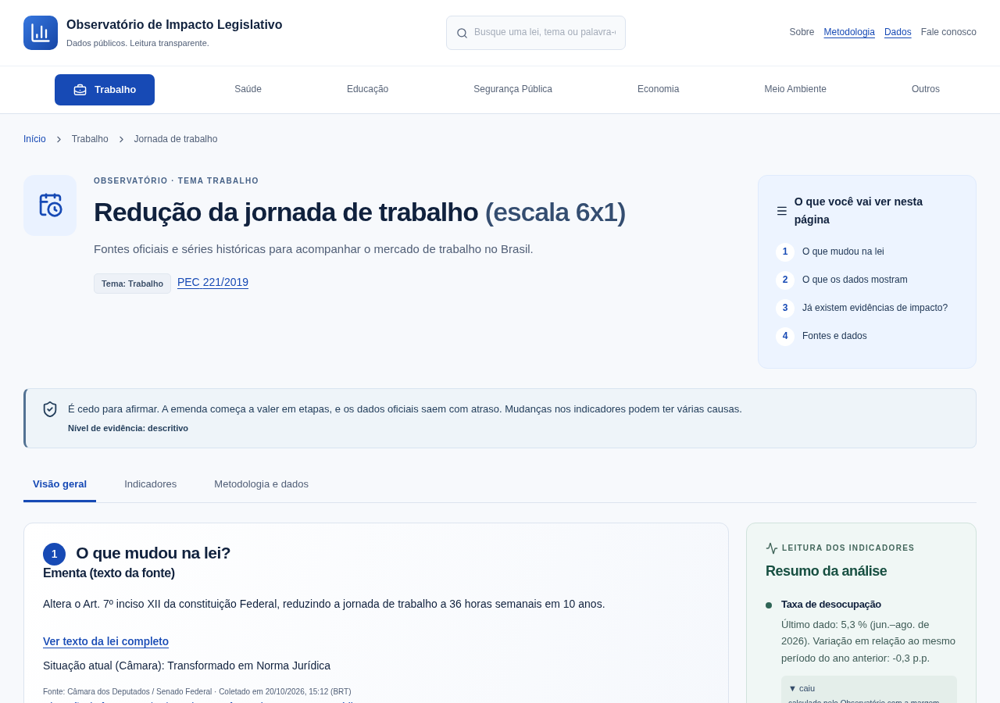
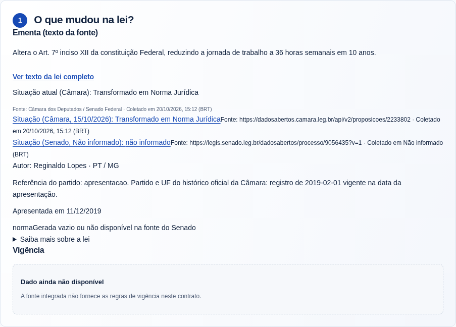
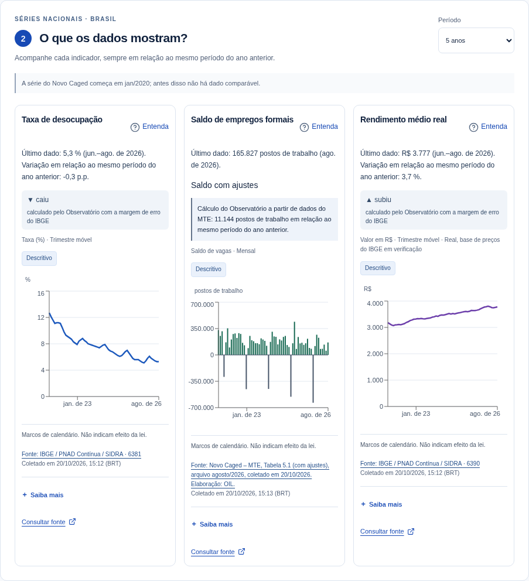
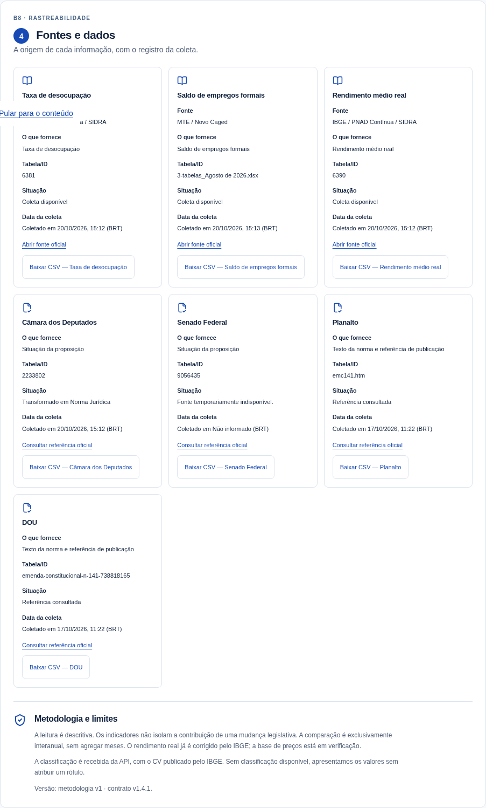

# Observatório de Impacto Legislativo (OIL)

> Dados públicos. Leitura transparente.

O OIL acompanha uma lei e mostra, numa só página, **o que mudou na lei**, **o que os dados oficiais mostram** e **de onde vem cada número**. É um projeto independente e com metodologia aberta. **Nenhum dado fictício é apresentado como real.** A Fase 1 é o dashboard.

O piloto atual é o tema **Trabalho**: a redução da jornada de trabalho (escala 6x1), com a PEC 221/2019 (Câmara, id 2233802), que virou a EC 141/2026.



> As imagens deste README são da tela do piloto Trabalho, capturadas em 1280 px com dados reais coletados das fontes oficiais em 20/10/2026. Os valores mudam a cada divulgação.

## Sumário

1. [O que é o projeto](#o-que-é-o-projeto)
2. [Metodologia transparente](#metodologia-transparente)
3. [Telas do piloto Trabalho](#telas-do-piloto-trabalho-escala-6x1)
4. [Arquitetura](#arquitetura)
5. [Fontes de dados](#fontes-de-dados)
6. [Contrato da API](#contrato-da-api)
7. [Estrutura de pastas](#estrutura-de-pastas)
8. [Como rodar localmente](#como-rodar-localmente)
9. [Como carregar os dados](#como-carregar-os-dados)
10. [Como rodar os testes](#como-rodar-os-testes)
11. [Guia de contribuição](#guia-de-contribuição)
12. [Roteiro](#roteiro)
13. [Documentação complementar](#documentação-complementar)

## O que é o projeto

Quando uma lei muda, pouca gente consegue ver de forma simples e honesta o que os dados oficiais estão mostrando. O OIL junta isso em uma página por lei:

1. **O que mudou na lei?** A ementa literal da fonte, a situação na Câmara e no Senado, os marcos de calendário e as fontes da norma.
2. **O que os dados mostram?** Séries nacionais (Brasil) do mercado de trabalho, sempre comparadas com o mesmo período do ano anterior.
3. **Já existem evidências de impacto?** A Fase 1 é **descritiva**. A página diz isso com clareza e não atribui efeito à lei.
4. **Fontes e dados.** Link oficial, data da coleta e metodologia de cada número.

O que o OIL **não** faz: interpretação jurídica de vigência, estimativa de efeito causal, dados aproximados, valores fixados no código ou fallback simulado no modo normal.

## Metodologia transparente

O detalhe está em [`docs/metodologia-o2.md`](docs/metodologia-o2.md). Em resumo:

- **Séries IBGE (PNAD Contínua, trimestre móvel, Brasil):**
  - Desocupação: tabela 6381, nível 4099 (%), CV 4103, variação anual 8816 (p.p.).
  - Rendimento médio mensal real habitual: tabela 6390, nível 5933 (R$), CV 5941, variação anual 8837 (%), diferença para classificação 8838 (R$). Não há nova deflação.
- **Comparação:** sempre com o **mesmo período do ano anterior**.
- **Classificação `subiu` / `caiu` / `estavel`:** calculada pelo Observatório com a margem de erro do IBGE:

  ```text
  ep_atual    = cv_atual / 100 × valor_atual
  ep_anterior = cv_anterior / 100 × valor_anterior
  ep_dif      = sqrt(ep_atual² + ep_anterior²)
  margem      = 1,96 × ep_dif
  estavel se abs(dif) <= margem   (limite inclusivo)
  subiu   se dif > margem
  caiu    se dif < -margem
  ```

  Sem algum dos insumos, a classificação é `null`. O código usa `Decimal` e testa a fronteira.
- **Limites declarados:** a fórmula não modela a covariância da amostra entre anos. Trimestres móveis vizinhos compartilham meses. O rendimento médio sofre efeito de composição. **Nada disso identifica efeito de uma lei.**
- **Novo Caged:** usa o saldo **com ajustes** da Tabela 5.1, a partir de jan/2020. A variação anual é um cálculo do Observatório, identificado como tal. A classificação é `null`.
- **Linhagem:** cada coleta guarda URL, status HTTP, instante em UTC e SHA-256. Cada revisão da fonte gera uma nova versão do ponto, e as versões antigas ficam guardadas.
- **Estados honestos:**
  - `desatualizado=true` quando a última tentativa falhou e há dados válidos anteriores.
  - `atrasado_calendario=true` só quando uma data oficial cadastrada já passou sem o período esperado.
  - Sem coleta válida, a API devolve um erro estruturado ou `disponivel=false`, nunca um valor inventado.

## Telas do piloto Trabalho (escala 6x1)

**1 · O que mudou na lei?** Ementa literal, situação na Câmara e no Senado, marcos e fontes da norma.



**2 · O que os dados mostram?** Desocupação, saldo do Novo Caged e rendimento real, com classificação e fonte em cada cartão.



**4 · Fontes e dados.** Rastreabilidade de cada número e da norma.



A página inteira está em [`docs/img/trabalho-6x1-pagina-inteira.png`](docs/img/trabalho-6x1-pagina-inteira.png).

## Arquitetura

```text
Navegador ──► Next.js (frontend/, porta 3100)
                 └─ /api/oil/*  (proxy no servidor: cache 15 s, limite 60/min)
                        └─► FastAPI (backend/oil, porta 8766 ou 8000)
                               └─► PostgreSQL 17 (migrações Alembic)
Jobs de coleta (CLI, separados da API) ──► Câmara, Senado, IBGE SIDRA, MTE/Novo Caged (HTTPX)
```

| Camada | Tecnologia | Onde |
| --- | --- | --- |
| Tela | Next.js (App Router), TypeScript, Tailwind CSS, Recharts | `frontend/` |
| API | FastAPI, Pydantic, SQLAlchemy | `backend/oil/main.py` |
| Banco | PostgreSQL 17 com migrações Alembic | `backend/alembic/` |
| Coleta | HTTPX com `truststore`, sem `verify=False`; streaming com SHA-256 no Caged; `openpyxl` + `defusedxml` | `backend/oil/sidra.py`, `legislation.py`, `caged.py` |
| Testes | Pytest (backend e PoC), Playwright + axe (frontend) | `backend/tests/`, `poc/`, `frontend/tests/` |

Princípios:

- **Os GETs da API leem só o banco.** Quem coleta são os jobs de CLI.
- **O navegador nunca chama fontes externas.** Ele fala só com `/api/oil`, e a URL do backend fica no servidor.
- **Nenhum arquivo `.env` é lido automaticamente.** Configure as variáveis no ambiente do processo. `.env.example` e `frontend/.env.example` só listam os nomes.
- **Links externos passam por `safeHref()`:** só HTTPS de domínios oficiais.
- **CSV protegido contra fórmulas.**
- **Cabeçalhos CSP e `nosniff`** ficam ativos.

## Fontes de dados

| Fonte | O que vem | Base / observação |
| --- | --- | --- |
| [Câmara dos Deputados — Dados Abertos](https://dadosabertos.camara.leg.br/swagger/api.html) | Proposição 2233802: ementa, autoria, situação | Lista fixa da Fase 1 em `backend/oil/catalog.py` |
| Senado Federal | Situação da matéria vinculada (id 9056435) | Vínculo conferido manualmente, nunca por busca |
| [IBGE — SIDRA / API de agregados v3](https://servicodados.ibge.gov.br/api/docs/agregados?versao=3) | Tabelas 6381 (desocupação) e 6390 (rendimento real) | Metadados conferidos antes dos valores |
| MTE — Novo Caged | Tabela 5.1, saldo com ajustes | Uso livre com citação da fonte: [Decreto nº 8.777/2016, art. 4º e §1º](https://www.planalto.gov.br/ccivil_03/_ato2015-2018/2016/decreto/d8777.htm), com redação do Decreto nº 9.903/2019. O MTE não publica licença própria para esses dados. |

Os arquivos do Caged vêm do manifesto conferido por uma pessoa: [`backend/data/caged_manifesto.json`](backend/data/caged_manifesto.json). O SHA-256 é obrigatório antes do download, os redirecionamentos não são seguidos e o arquivo tem tetos de tamanho e de descompactação. Os detalhes estão em [`docs/o3/spec-b4-caged.md`](docs/o3/spec-b4-caged.md) e [`backend/README.md`](backend/README.md).

> **Atenção:** os recortes de planilhas em `backend/tests/fixtures/o3/` existem só para os testes automáticos e **não devem ser redistribuídos**. Veja [`backend/tests/fixtures/o3/README.md`](backend/tests/fixtures/o3/README.md).

## Contrato da API

Rotas em `backend/oil/main.py`. O OpenAPI interativo fica em `/docs`.

- `GET /api/v1/indicadores` — índice dos indicadores.
- `GET /api/v1/indicadores/{codigo}/serie?janela=5a|2a|desde_2020` — série (`desocupacao`, `rendimento-real`, `caged-saldo`).
- `GET /api/v1/indicadores/caged-saldo` — Novo Caged, com bloco `atribuicao`.
- `GET /api/v1/proposicoes/{id_camara}` — lei acompanhada (Fase 1: `2233802`).

Versões:

- O `main` implementa o contrato **v1.4.1**: [`docs/o3/contrato-api-v1.4.1-delta.md`](docs/o3/contrato-api-v1.4.1-delta.md) e [`openapi-v1.4.1.json`](docs/o3/openapi-v1.4.1.json), sobre a base [v1.3](docs/contrato-api-v1.3-indicadores.md) e o [delta v1.4](docs/o3/contrato-api-v1.4-delta.md).
- O contrato **v1.5.0** foi aprovado e está em implementação em PR próprio, ainda fora do `main`. Ele muda só o bloco `atribuicao` do Caged:
  - texto fixo, sem data e sem licença;
  - `base_legal` = "Decreto 8.777/2016, art. 4º";
  - novos campos `arquivo_referencia` e `coletado_em`.

  Os números não mudam.

## Estrutura de pastas

```text
.
├── backend/
│   ├── oil/              # API FastAPI, coletores (sidra, legislation, caged), classificação, CLIs
│   ├── alembic/          # migrações 0001–0004 (séries, contrato 1.3.1, legislação, Caged)
│   ├── data/             # manifesto do Caged e fontes da norma (conferidos por uma pessoa)
│   ├── scripts/          # test_postgres.py (banco descartável) e mutações
│   ├── tests/            # Pytest + fixtures gravadas (replay sempre marcado como simulado)
│   └── evidencias/       # evidências de validação versionadas
├── frontend/
│   ├── app/              # páginas e rotas /api/oil (proxy para a API)
│   ├── components/       # dashboard, gráfico, lei, vigência, votação, fontes
│   ├── lib/              # tipos do contrato, CSV seguro, safeHref, vigência
│   ├── tests/            # Playwright (e2e, axe, mutações, captura real)
│   ├── referencias/      # spec da tela e missões
│   └── evidencias/       # capturas de validação
├── poc/                  # prova de conceito original (39 testes, preservada)
├── docs/
│   ├── metodologia-o2.md # metodologia das séries IBGE
│   ├── o3/               # contratos, OpenAPI, operação, specs e validação
│   └── img/              # imagens deste README
├── .env.example          # nomes das variáveis (sem valores reais)
├── .gitleaks.toml        # configuração do gitleaks
└── .pre-commit-config.yaml
```

## Como rodar localmente

Pré-requisitos: **Python 3.13**, **Node.js** (com npm), **Docker** (para o PostgreSQL e os testes) e Git. Os exemplos de PowerShell valem para o Windows. No Linux ou macOS, troque `.\.venv\Scripts\python.exe` por `.venv/bin/python` e `$env:VAR='x'` por `export VAR=x`.

Hoje o Docker é usado para o **PostgreSQL**. A API e o frontend rodam direto com Python e Node. Ainda não há Dockerfile para eles.

### 1. PostgreSQL no Docker

Defina `POSTGRES_USER`, `POSTGRES_PASSWORD` e `POSTGRES_DB` **no ambiente do processo**, escolhendo valores seus e sem versionar. Depois rode:

```powershell
docker run --name oil-postgres --detach --publish 127.0.0.1:5432:5432 `
  --env POSTGRES_USER --env POSTGRES_PASSWORD --env POSTGRES_DB `
  --volume oil-postgres-data:/var/lib/postgresql/data `
  postgres:17@sha256:2d2b8998d31037bf721cfdf764d76ba74171b4fab3431b7f72c27c56ddbdf9e3
```

### 2. API (FastAPI)

```powershell
python -m venv .venv
.\.venv\Scripts\python.exe -m pip install -r backend/requirements.txt
$env:DATABASE_URL='postgresql+psycopg://<usuario>:<senha>@127.0.0.1:5432/<banco>'
.\.venv\Scripts\python.exe -m alembic -c backend/alembic.ini upgrade head
.\.venv\Scripts\python.exe -m uvicorn backend.oil.main:app --host 127.0.0.1 --port 8766
```

Não há URL padrão nem fallback para SQLite: `DATABASE_URL` é obrigatória. Teste com `http://127.0.0.1:8766/api/v1/indicadores` ou `http://127.0.0.1:8766/docs`.

### 3. Frontend (Next.js)

```powershell
cd frontend
npm ci
$env:NEXT_TELEMETRY_DISABLED='1'
$env:OIL_API_URL='http://127.0.0.1:8766'
$env:OIL_TEST_MODE='0'
npm run build
npm start
```

Abra http://127.0.0.1:3100. Use `OIL_TEST_MODE=1` só nos testes: ele habilita dados de demonstração marcados como simulados. A API e o site escutam só em loopback.

## Como carregar os dados

Os jobs fazem **coleta real** das fontes oficiais e gravam no banco. Rode a partir da raiz, com `DATABASE_URL` definida:

```powershell
# IBGE: desocupação e rendimento real (série nacional completa)
.\.venv\Scripts\python.exe -m backend.oil.cli desocupacao rendimento-real
# Lei acompanhada (Câmara + Senado)
.\.venv\Scripts\python.exe -m backend.oil.o3_cli lei
# Novo Caged de uma competência listada no manifesto
.\.venv\Scripts\python.exe -m backend.oil.o3_cli caged 2026-08
# Calendário de divulgação do Caged (sem rede)
.\.venv\Scripts\python.exe -m backend.oil.o3_cli calendario-caged
```

- O calendário do IBGE é cadastrado à mão, só com data oficial conferida: `python -m backend.oil.calendar --help`.
- Prazos do download do Caged: `OIL_CAGED_READ_TIMEOUT` (padrão 120 s, máximo 300) e `OIL_CAGED_ATTEMPT_TIMEOUT` (padrão 300 s, teto 300). Veja [`backend/README.md`](backend/README.md).
- Para incluir uma nova competência do Caged, atualize `backend/data/caged_manifesto.json` com o hash do arquivo original e a conferência de uma pessoa. A descoberta não é automática.
- Se uma fonte falhar, o job registra a tentativa e sai com código diferente de zero. Os dados válidos anteriores continuam servidos, marcados como `desatualizado`.

## Como rodar os testes

Os testes **não acessam a rede**. As fixtures são respostas gravadas da fonte real, e o replay é sempre marcado como simulado.

### Backend e PoC (Pytest + PostgreSQL descartável no Docker)

```powershell
$env:PYTEST_DISABLE_PLUGIN_AUTOLOAD='1'
.\.venv\Scripts\python.exe backend/scripts/test_postgres.py
```

O script sobe um PostgreSQL **descartável** no Docker, com nome aleatório, senha efêmera e porta dinâmica em loopback. Ele ignora qualquer `DATABASE_URL` sua, roda a suíte do backend (incluindo upgrade/downgrade das migrações) e os 39 testes da PoC, e remove o contêiner no fim. Para rodar só um arquivo: `backend/scripts/test_postgres.py backend/tests/test_caged_timeout.py`.

Os testes ao vivo do IBGE são opcionais e ficam desligados por padrão (`RUN_LIVE_IBGE=1` e `-m live`).

### Frontend (TypeScript + Playwright + axe)

```powershell
cd frontend
npm ci --ignore-scripts --no-audit --no-fund
$env:NEXT_TELEMETRY_DISABLED='1'
$env:OIL_BROWSER_CHANNEL='msedge'   # Linux: chromium
npm run typecheck
npm run build
npm run test:e2e
```

Os testes sobem servidores próprios nas portas 3101 e 3102.

### Verificações opcionais

- **Mutações intencionais:** exigem checkout limpo.

  ```powershell
  .\.venv\Scripts\python.exe backend/scripts/check_mutations_o3.py
  ```

  ```powershell
  cd frontend
  node tests/check-mutations.mjs
  ```

- **Captura real:** com a API em 8766 e o site em 3100, rode `node tests/capture-real.mjs`.
- **Segredos:** `gitleaks` está configurado em `.gitleaks.toml` e no `pre-commit`.

## Guia de contribuição

Contribuições são bem-vindas. Leia a [metodologia](docs/metodologia-o2.md) antes de mudar qualquer número ou texto da tela.

1. **Branch:** crie a partir do `main` atualizado, com prefixo pelo tipo: `feat/…`, `fix/…`, `docs/…`, `test/…`. Commits no estilo do histórico: `fix(caged): …`, `test(caged): …`, `docs(o4): …`.
2. **Testes no Docker local, antes do PR:** rode a suíte do backend (`test_postgres.py`) e a do frontend (`typecheck`, `build`, `test:e2e`). Mudanças de comportamento precisam vir com teste, de preferência escrito antes da correção.
3. **PR em rascunho (draft):** abra o PR como rascunho e descreva o que mudou, como testou (comandos e resultados) e os limites conhecidos.
4. **CI só antes do merge:** a validação em CI roda uma vez, quando o PR está pronto para entrar, e não a cada push.
5. **Merge no `main`:** só com aprovação de quem mantém o projeto. Não faça force push em branch de outra pessoa.
6. **Sem segredos:** nunca versione `.env`, senhas, tokens ou caminhos da sua máquina. Rode `gitleaks` antes do push.
7. **Regras de dados:**
   - nada de valor fixado, dado aproximado ou fallback simulado no modo normal;
   - toda mudança de contrato da API vira um novo documento de versão em `docs/`;
   - mudanças de schema exigem uma migração Alembic reversível e segura.
8. **Linguagem:** a tela é descritiva. Não atribua efeito à lei nem use termos causais.

## Roteiro

Itens que já constam nos documentos do repositório e nos PRs em andamento:

- **Contrato v1.5.0 do Caged:** nova atribuição, sem licença e com `arquivo_referencia`; a tela acompanha no mesmo ciclo.
- **Verificação ponta a ponta (`check.py`)** com os arquivos reais do Caged.
- **Votações e tramitação (B2b):** votos e placares da Câmara. Hoje a tela mostra «Dado ainda não disponível».
- **Pendências da O3** ([`docs/o3/VALIDACAO.md`](docs/o3/VALIDACAO.md)):
  - P1: critério de partido do autor;
  - P2: fonte direta do marco de promulgação;
  - `base_precos` da tabela 6390.
- **Robustez do job Caged:** prazo total do job e evidência do gitleaks em JSON.
- **Próximos temas:** a navegação já prevê Saúde, Educação, Segurança Pública, Economia e Meio Ambiente. Hoje só o tema Trabalho tem conteúdo.
- **Antes de uso público:**
  - definir a licença do código;
  - decidir hospedagem e autenticação;
  - empacotar a API e o frontend em contêineres.

## Documentação complementar

- [`backend/README.md`](backend/README.md) — banco, ingestão, calendário, persistência e limites.
- [`frontend/README.md`](frontend/README.md) — tela, proxy, proteções e testes.
- [`docs/o3/operacao.md`](docs/o3/operacao.md) — operação local da O3 (lei e Caged).
- [`docs/o3/VALIDACAO.md`](docs/o3/VALIDACAO.md) e [`frontend/VALIDACAO.md`](frontend/VALIDACAO.md) — validações e evidências.
- [`poc/README.md`](poc/README.md) e [`poc/RELATORIO.md`](poc/RELATORIO.md) — prova de conceito original.

---

**Licença:** ainda não definida.
